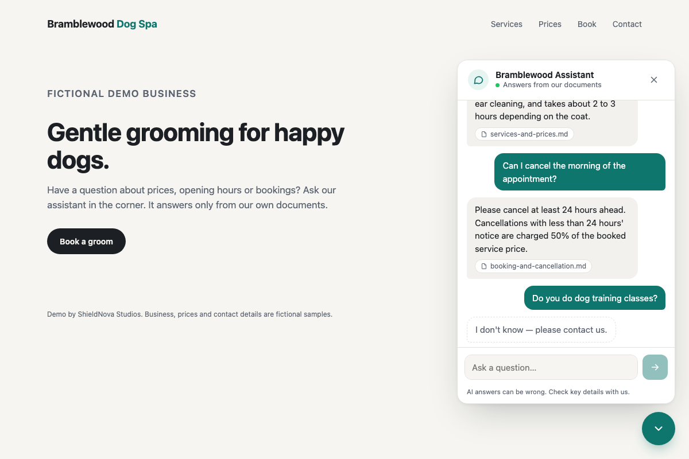

# Claude Docs Chatbot

A small chatbot for your website that answers customer questions **only from your own documents**, using the Claude API from Anthropic. If the answer is not in your documents, it says *"I don't know — please contact us."* instead of guessing. Every answer shows which document it came from.

Built by **ShieldNova Studios** as a working demo. The sample business in `docs/` (Bramblewood Dog Spa) is fictional, and so are its prices, address and contact details.



## What it does, in plain words

- You put your FAQ, price list, opening hours and policies in a folder as simple text files.
- A visitor asks a question in the chat bubble on your website.
- The bot looks through your files, picks the few paragraphs that match, and asks Claude to answer **using only those paragraphs**.
- The answer comes back with a small label naming the source file, so you (and the visitor) can see where it came from.
- If nothing in your files matches, the bot says it doesn't know and asks the visitor to contact you. In that case no request is sent to Claude, so it costs nothing.

## How it stays honest

1. **Search first.** Questions that don't match anything in your documents are declined before any AI call.
2. **Only the matching paragraphs go to Claude**, with the API's *citations* feature turned on, so every statement is tied to a quoted passage.
3. **A strict instruction**: use only the documents, never invent prices or policies, say "I don't know" otherwise.
4. **No citation, no answer.** If Claude replies without quoting a document, the bot shows "I don't know" instead.

## Cost

The business pays for its own API usage on its own Anthropic account (pay-as-you-go, billed by Anthropic). There is no fee from this code.

**Rough estimate, not a quote:** with the default model, Claude Opus 5.5 (listed at $4 per million input tokens and $20 per million output tokens at the time of writing), a typical question sends about 1,500 input tokens (instructions + 4 matching paragraphs + the question) and gets about 300 output tokens back (including the model's internal reasoning). That is roughly **1 to 2 cents per answered question**, or about **$10–20 per 1,000 questions**. Declined questions with no matching document cost nothing. Real costs depend on your documents, question length and Anthropic's current prices; check [Anthropic's pricing page](https://www.anthropic.com/pricing) and set a monthly spend limit in the Anthropic Console.

To spend less, you can switch to a smaller model with `CHATBOT_MODEL=claude-haiku-5-5` (much cheaper per question, less careful on tricky questions). Test it on your own documents before choosing.

The system prompt is marked for **prompt caching**. With the short sample prompt it is below the minimum size the API caches, so it has no effect yet; if you add longer standing instructions, repeated questions reuse the cached part at a lower price.

## Quick start

Requires Python 3.9 or newer and an Anthropic API key.

```bash
python3 -m venv .venv
source .venv/bin/activate
pip install -r requirements.txt

cp .env.example .env              # then put your key in .env
export $(grep -v '^#' .env | xargs)

uvicorn app:app --port 8000
```

Open http://localhost:8000 and ask a question. Add `?demo=1` to the address to see a sample conversation without calling the API.

Ask from the terminal:

```bash
python cli.py "Are you open on Saturday?"
python cli.py                                 # interactive mode
python cli.py --search-only "parking"         # see which paragraphs match, no API call
```

Run the tests (no API key or network needed; the Claude client is mocked):

```bash
pip install -r requirements-dev.txt
python -m pytest
```

## Use your own documents

1. Delete the sample files in `docs/`.
2. Add your own `.md` or `.txt` files. Use headings (`## Cancellation policy`) and short paragraphs: each heading becomes a searchable section, and its title is shown as the source.
3. Restart the server. That's it; there is no database to rebuild.

Tips: one topic per section, write prices and times exactly as you want them repeated, and remove anything outdated. The bot can only be as accurate as your documents.

To point at another folder: `DOCS_DIR=/path/to/folder uvicorn app:app`.

## Put the widget on your website

Host this app (any server or platform that runs Python), then add this to your site, replacing the address:

```html
<iframe id="chat-frame" src="https://chat.example.com/?embed=1" title="Chat with our assistant"
        style="position:fixed;right:20px;bottom:90px;width:380px;height:560px;max-width:calc(100vw - 40px);
               border:0;border-radius:18px;box-shadow:0 20px 50px rgba(0,0,0,.25);display:none;z-index:9999"></iframe>
<button id="chat-toggle" aria-controls="chat-frame" aria-expanded="false"
        style="position:fixed;right:20px;bottom:20px;width:58px;height:58px;border-radius:50%;border:0;
               background:#0f766e;color:#fff;font-size:24px;cursor:pointer;z-index:9999">&#128172;<span style="position:absolute;left:-9999px">Open chat</span></button>
<script>
  document.getElementById("chat-toggle").addEventListener("click", function () {
    var f = document.getElementById("chat-frame"), open = f.style.display === "none";
    f.style.display = open ? "block" : "none";
    this.setAttribute("aria-expanded", String(open));
  });
</script>
```

Colors are set at the top of `static/index.html` (`--accent` and friends). The widget follows the visitor's light/dark setting; force one with `?theme=light` or `?theme=dark`.

## Settings

| Variable | Default | What it does |
|---|---|---|
| `ANTHROPIC_API_KEY` | (required) | Your key. Read only from the environment, never stored in code. |
| `CHATBOT_MODEL` | `claude-opus-5-5` | Which Claude model answers. |
| `DOCS_DIR` | `docs` | Folder with your documents. |
| `MAX_QUESTION_CHARS` | `500` | Longer questions are rejected. |
| `RATE_LIMIT_PER_MINUTE` | `10` | Questions allowed per visitor IP address per minute. |

## Privacy and safeguards

- Visitors' questions are **not saved to disk** and not written to the logs. They are sent to Anthropic's API to produce the answer; see Anthropic's privacy and data-retention terms for your account.
- Each question is answered on its own (no conversation memory on the server).
- Question length limit and a simple per-IP rate limit protect your API budget. The rate limit lives in memory: behind a proxy or with several server processes, put a proper limit at the proxy as well.
- The API key is never sent to the browser.

## Limits

- **Not for medical, veterinary, legal or financial advice.** The bot is told to decline those, but it is not a professional and shouldn't be presented as one.
- **Keep your documents up to date.** It will happily repeat an old price if the old price is in the files.
- AI answers can still be wrong or incomplete. The source label lets visitors check, and important details (bookings, payments) should be confirmed by a person.
- The simple keyword search works well for a few dozen pages. For hundreds of pages or questions phrased very differently from your text, upgrade the search (for example to embeddings).
- One answer per question; it does not remember earlier messages in the chat.

## Project layout

```
app.py              web server: POST /ask and the widget page
bot.py              grounded answering with Claude (citations, refusal rules)
kb.py               document loading, chunking and BM25 search (plain Python)
cli.py              terminal interface
static/index.html   the chat widget (vanilla JS, no build step)
docs/               sample knowledge base (fictional business)
tests/              pytest tests, Claude client mocked
```

## License

MIT. See [LICENSE](LICENSE). Copyright (c) 2026 ShieldNova Studios.
